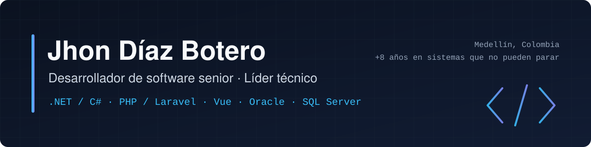

# Hola, soy Jhon

Desarrollador de software senior y líder técnico en Medellín, Colombia.

Llevo más de 8 años construyendo, modernizando y estabilizando aplicaciones de negocio para empresas privadas y algunas entidades públicas. Mi fuerte es el backend en .NET / C# y PHP / Laravel, con Oracle y SQL Server debajo. Cuando el proyecto lo pide, también hago el front con Vue y Nuxt.

## Qué hago

- Tomo sistemas heredados y los paso a una arquitectura por capas con APIs versionadas, sin parar la operación de los usuarios.
- Encuentro la causa de los errores que frenan procesos en producción y los corrijo de raíz.
- Hago más rápidas las consultas y los procesos masivos sobre Oracle y SQL Server.
- Lidero equipos de desarrollo: reparto el trabajo, reviso los pull requests y acompaño a los perfiles junior.
- Uso IA dentro del desarrollo con reglas claras. Cada resultado se revisa contra el código y los datos reales antes de integrarlo.

## Con qué trabajo

| Área | Tecnologías |
|---|---|
| Backend | C#, ASP.NET Core, Entity Framework Core, Dapper, PHP, Laravel, Node.js, NestJS |
| Front | Vue.js, Nuxt.js, Inertia, TypeScript |
| Bases de datos | Oracle (PL/SQL), SQL Server (T-SQL), PostgreSQL, MySQL |
| Arquitectura | Capas, Clean Architecture, microservicios, APIs REST, DDD, CQRS |
| Herramientas | Git, Docker, CI/CD, xUnit, Postman |

## Cómo trabajo

- Por fases, con entregas que se pueden revisar y probar en cada paso.
- Dejo documentado lo que importa: decisiones de arquitectura, modelo de datos y manual de despliegue.
- Cada commit se puede rastrear hasta la tarea que lo pidió.
- Nada pasa a producción sin pruebas y sin plan de reversa.

## Contacto

[LinkedIn](https://www.linkedin.com/in/jhon-bayron-diaz-botero-45a5951b8)
